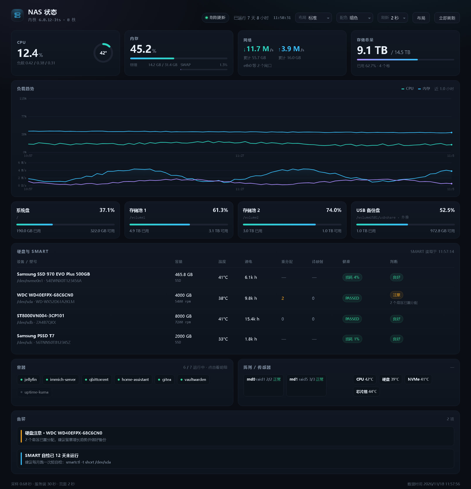

# NAS Dash

[](LICENSE)
[](https://www.python.org/)
[](#why)
[](#compatibility)

**A NAS dashboard in one Python file and one HTML file.** No third-party packages, no frontend build step. It reads `/proc`, `/sys`, `df`, `smartctl` and `docker`, samples every 5 seconds, keeps a short history, raises warnings, and ships a ready-to-install fnOS (FeiNiu) app package.



> [中文](README.md)

## Why

There is no shortage of NAS monitoring — what's missing is the "just upload it and it runs" kind. The trade-offs here:

- **No dependencies.** No Docker, no Node, no database, no Prometheus. A NAS almost always has `python3`; copy two files and you're done.
- **Read-only.** It doesn't touch system config or write to disks; the only writes are its own history files.
- **Cheap to sample.** About 110 ms of CPU per round. SMART is throttled separately (5 min by default) so the panel doesn't keep waking your drives.
- **Fine on weak hardware.** Low-memory devices and old iPads get a degraded mode: no backdrop blur, DPR capped at 1.5, 5-second refresh by default.
- **The dashboard itself is adjustable.** Modules can be dragged, resized and hidden; themes and density switch instantly; the layout lives in `localStorage`.

## Features

| Module | What it shows | Source |
|---|---|---|
| Overview | CPU usage/temp, memory + swap, network rate, total capacity | `/proc/stat`, `/proc/meminfo`, `/proc/net/dev`, `df` |
| Trend | Last hour of CPU / memory / network | Server-side ring buffer (8640 points) |
| Volumes | Per-mount usage, free space, internal vs external | `df -kP` |
| Disks & SMART | Model, capacity, temperature, power-on hours, reallocated/pending sectors, health verdict | `smartctl` (auto `-d sat` for USB bridges) |
| Containers | Status and image, **click through for per-container CPU / memory / network** | `docker ps` + cgroup v2 |
| RAID / sensors | mdadm array state, board/CPU/drive/NVMe temps | `/proc/mdstat`, `sensors` |
| Warnings | swap pressure, filling volumes, reallocated sectors, high temps, overdue self-test | Built-in rules, sorted in the UI |

Interaction:

- **Layout**: drag to reorder, cycle 1/2/3/6-column width, hide modules, reset to default.
- **Four themes** (night / paper / mono / glass) and three density levels.
- **Refresh interval 1–60 s**, persisted in `localStorage`; polling pauses in background tabs.
- **ETag / 304** responses: unchanged data is never re-sent.

## Quick start

### 1. Run it on the NAS (recommended)

```bash
mkdir -p /opt/nasdash && cd /opt/nasdash
curl -fsSLO https://raw.githubusercontent.com/jhonlinus/nas-dash/main/nasdash.py
curl -fsSLO https://raw.githubusercontent.com/jhonlinus/nas-dash/main/index.html
python3 nasdash.py --mode local --port 8066
```

Open `http://<nas-ip>:8066`. It binds to `127.0.0.1` by default; add `--bind 0.0.0.0` for LAN access.

### 2. Watch a remote NAS from your laptop

```bash
python3 nasdash.py --mode ssh --remote 'ssh -o BatchMode=yes root@nas.local {cmd}' --port 8066
```

`--remote` is any command template that runs a command non-interactively — a bastion script, `docker exec`, `sshpass`, whatever:

```bash
--remote 'python3 jssh.py exec my-nas {cmd}'
--remote 'docker exec nas-dash {cmd}'
```

### 3. systemd

```bash
sudo install -m 755 nasdash.py /opt/nasdash/nasdash.py
sudo install -m 644 index.html /opt/nasdash/index.html
sudo install -m 644 deploy/nas-dash.service /etc/systemd/system/
sudo systemctl daemon-reload && sudo systemctl enable --now nas-dash
```

Listens on `127.0.0.1:8066`; put a reverse proxy in front of it.

### 4. fnOS (FeiNiu) app

`fnos/` is a complete fpk project, and a prebuilt package is included:

1. App Center → Settings → Install app manually → pick `fnos/dist/nasdash-*.fpk`
2. A "NAS 状态面板" icon appears on the desktop

It is served through the fnOS gateway at `/app/nasdash/`, so it uses no port and works over FN Connect from outside. Details in [`fnos/README.md`](fnos/README.md) (Chinese).

### 5. Docker (experimental)

```bash
docker compose up -d
```

Inside a container, `/proc` and `df` show the container's own view, so only part of the metrics are meaningful. Host data requires `pid: host` plus bind mounts for `/sys` and `docker.sock` — see the comments in `docker-compose.yml`.

## Options

| Flag | Default | Description |
|---|---|---|
| `--mode` | `local` | `local` samples the host; `ssh` delegates to `--remote` |
| `--remote` | empty | Command template for `ssh` mode; `{cmd}` is the placeholder |
| `--port` | `8066` | TCP port, `0` disables TCP |
| `--bind` | `127.0.0.1` | Bind address; use `0.0.0.0` in containers or for LAN access |
| `--sock` | empty | Extra Unix socket listener (fnOS gateway, e.g. `$TRIM_APPDEST/app.sock`) |
| `--auth` | empty | HTTP Basic auth as `user:pass`; empty = no auth |
| `--interval` | `30` | Server-side sampling interval in seconds |
| `--redact` | off | Hide drive serial numbers |
| `--no-sample` | off | Serve the cached snapshot without sampling (UI work, screenshots) |
| `--no-gateway-trust` | off | Ignore the login identity injected by the fnOS gateway |
| `--debug` | off | Log HTTP requests to `data/requests.log` |

The data directory defaults to `data/` next to the script and can be overridden with `NASDASH_DATA`.

## Security

The defaults are "loopback only, no auth" — i.e. reachable from the NAS itself. Exposing it means putting an authenticating proxy in front:

```nginx
location / {
    auth_basic "NAS Dash";
    auth_basic_user_file /etc/nginx/dash.pass;

    proxy_pass http://127.0.0.1:8066;
    proxy_set_header Host $host;
    # identity headers injected by the fnOS gateway — strip them on public entry points
    proxy_set_header X-Trim-Userid "";
    proxy_set_header X-Trim-Username "";
    proxy_set_header X-Trim-Isadmin "";
    limit_except GET { deny all; }
}
```

A full example lives in [`deploy/nginx.conf.example`](deploy/nginx.conf.example).

Three things worth repeating:

- **Never expose `--bind 0.0.0.0 --port 8066` to the internet.** The panel shows container names, volume usage and drive health.
- **`--redact` only hides serial numbers**, it is not authentication.
- **Gateway trust (`X-Trim-*`) is only honoured from 127.0.0.1**, so a reverse proxy must clear those headers.

## How it works

```
        every N seconds                          per request
 ┌──────────────────────────┐          ┌──────────────────────────┐
 │ one bash sampling script │          │ /api/snapshot → last snap │
 │  @@HOST @@MEM @@CPU ...  │  ──────► │ /api/history  → points    │
 │ parsed into a dict       │  cache   │ /api/refresh  → sample now│
 └──────────────────────────┘          └──────────────────────────┘
              │                                      │
              └──────────► data/history.json ────────┘
```

- Sampling is a **single bash round trip** that prints `@@SECTION` blocks; Python parses them. One process spawn per round, which matters in `ssh` mode.
- Container metrics skip `docker stats` (fixed 2-second latency, worse with more containers) and read cgroup v2 `cpu.stat` / `memory.current` directly — cost is nearly independent of container count.
- The frontend is vanilla JS + Canvas: no framework, no build step.
- Weak devices get `<html data-lite>` (`navigator.deviceMemory <= 2` or iOS < 16), which disables `backdrop-filter`, caps DPR and relaxes the refresh interval.

## Layout

```
.
├── nasdash.py              # server: sampling + parsing + HTTP (single file, no deps)
├── index.html              # frontend: layout, charts, themes (single file, no build)
├── Dockerfile
├── docker-compose.yml
├── deploy/
│   ├── nas-dash.service
│   └── nginx.conf.example
├── docs/
│   ├── screenshot.png
│   └── 1panel.md           # 1Panel site layout notes (Chinese)
└── fnos/                   # fnOS app project (fpk)
```

## Compatibility

- **OS**: any Linux with `/proc` (Synology, fnOS, TrueNAS, regular distros). BSD/macOS untested.
- **Python**: 3.8+, standard library only.
- **Optional tools**: `docker`, `smartctl`, `sensors`, `mdadm`. Missing ones just leave their module empty.
- **Windows**: `--mode ssh` only; local sampling needs `/proc`.
- **Privileges**: SMART and `docker ps` need root (or the docker group + a setuid `smartctl`). Running unprivileged just hides those two modules.

## Known limitations

- History lives in memory + one JSON file, 8640 points (~12 h at 5 s). No long-term storage; use Prometheus if you need that.
- Warnings are UI-only — no push notifications. Poll `/api/snapshot` and forward the `warnings` array if you want them elsewhere.
- Single host only, no aggregation.

## License

[MIT](LICENSE) © 2026 JhonLinus
