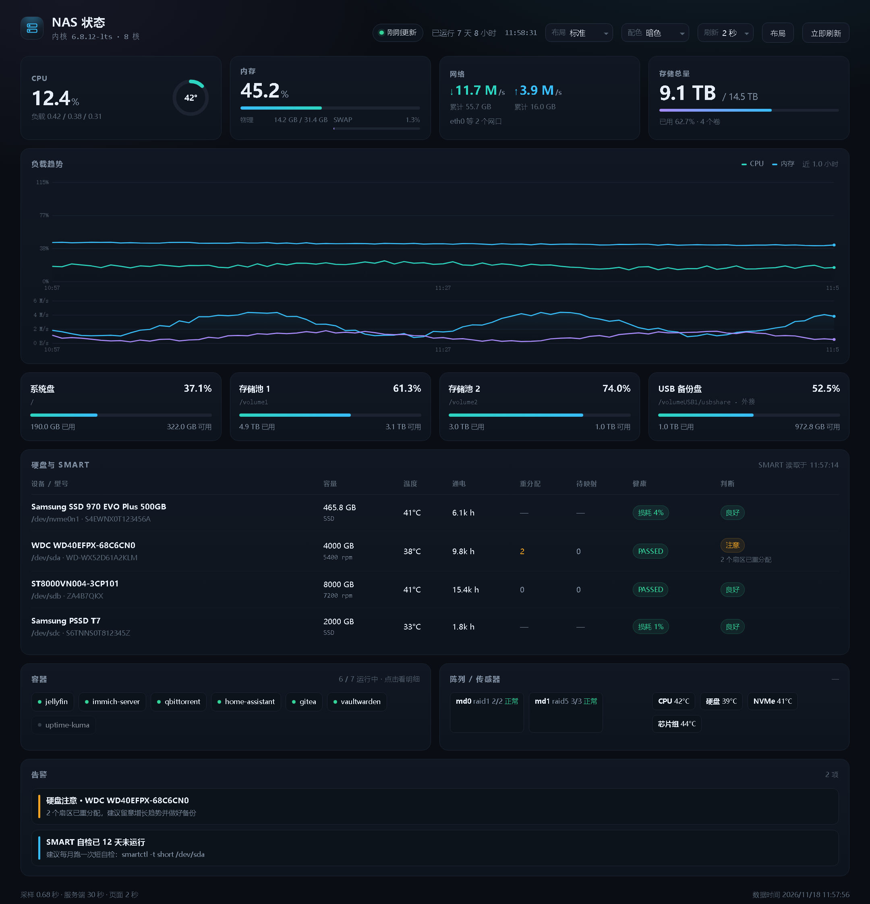

# NAS Dash

[](LICENSE)
[](https://www.python.org/)
[](#为什么是它)
[](#兼容性)

**一个 Python 文件 + 一个 HTML 文件的 NAS 状态面板。** 零第三方依赖、零前端构建，直接读 `/proc`、`/sys`、`df`、`smartctl`、`docker`，5 秒采样，自带历史曲线和告警，另附飞牛 fnOS 应用包。



> [English](README.en.md)

## 为什么是它

市面上不缺 NAS 监控，缺的是「装完就能用」的那种。这个项目的取舍：

- **不引入任何依赖。** 不需要 Docker、Node、数据库、Prometheus。NAS 上一般都有 `python3`，传两个文件进去就能跑。
- **只读。** 不改系统配置、不写磁盘、不常驻 root 之外的额外权限；唯一的写入是自己目录下的历史数据。
- **采集开销很低。** 一轮采样约 110 ms CPU；SMART 单独节流（默认 5 分钟一次），不会因为面板把硬盘叫醒。
- **弱设备不卡。** 检测到低内存设备或老 iPad Safari 会自动降级：关毛玻璃、DPR 上限 1.5、默认刷新拉到 5 秒。
- **面板本身可改。** 模块能拖、能调宽、能隐藏，配色和密度可切，配置存在浏览器里，不动服务端。

## 功能

| 模块 | 内容 | 数据来源 |
|---|---|---|
| 总览 | CPU 使用率/频率/温度、内存与 swap、网络速率、总容量 | `/proc/stat`、`/proc/meminfo`、`/proc/net/dev`、`df` |
| 负载趋势 | 最近 1 小时 CPU / 内存 / 网络双图 | 服务端环形缓冲（8640 点） |
| 存储卷 | 每个挂载点的用量、可用空间、内部/外接标记 | `df -kP` |
| 硬盘与 SMART | 型号、容量、温度、通电时间、重分配/待映射扇区、健康判定 | `smartctl`（USB 桥自动 `-d sat`） |
| 容器 | 运行状态与镜像，**点开看每个容器的 CPU / 内存 / 网络明细** | `docker ps` + cgroup v2 |
| 阵列 / 传感器 | mdadm 阵列状态、主板/CPU/硬盘/NVMe 温度 | `/proc/mdstat`、`sensors` |
| 告警 | swap 吃紧、卷将满、磁盘重分配、温度过高、SMART 未自检等 | 内置规则，前端排序展示 |

交互方面：

- **布局自由**：拖动模块换位置、点 `⟨` `⟩` 循环切换 1/2/3/6 列宽、`×` 隐藏，一键恢复默认。
- **四套配色**：夜（默认）/ 纸 / 单色 / 玻璃，三档密度。
- **刷新间隔 1–60 秒**，存在 `localStorage`；后台标签页自动暂停。
- **服务端 ETag / 304**：数据没变就不重传，弱网和低端设备省流量省电。

## 快速开始

### 方式一：直接在 NAS 上跑（推荐）

NAS 上一般自带 `python3`，把两个文件放同一个目录即可：

```bash
mkdir -p /opt/nasdash && cd /opt/nasdash
curl -fsSLO https://raw.githubusercontent.com/jhonlinus/nas-dash/main/nasdash.py
curl -fsSLO https://raw.githubusercontent.com/jhonlinus/nas-dash/main/index.html
python3 nasdash.py --mode local --port 8066
```

打开 `http://<NAS-IP>:8066`。默认只监听 `127.0.0.1`，要局域网直连加 `--bind 0.0.0.0`。

### 方式二：本机看远程 NAS

本机（Windows/macOS 都行）只负责显示，采集通过 ssh 在 NAS 上执行：

```bash
python3 nasdash.py --mode ssh --remote 'ssh -o BatchMode=yes root@nas.local {cmd}' --port 8066
```

`--remote` 只要能非交互执行一条命令就行，跳板机脚本、`docker exec`、`sshpass` 都能塞进去：

```bash
--remote 'python3 jssh.py exec my-nas {cmd}'      # 自建跳板脚本
--remote 'docker exec nas-dash {cmd}'             # 采集跑在容器里
```

### 方式三：systemd

```bash
sudo install -m 755 nasdash.py /opt/nasdash/nasdash.py
sudo install -m 644 index.html /opt/nasdash/index.html
sudo install -m 644 deploy/nas-dash.service /etc/systemd/system/
sudo systemctl daemon-reload && sudo systemctl enable --now nas-dash
```

默认监听 `127.0.0.1:8066`，由反代对外。改端口/参数就改 service 里的 `ExecStart`。

### 方式四：飞牛 fnOS 应用

`fnos/` 是完整的 fpk 工程，也可以用打包好的安装包直装：

1. 应用中心 → 设置 → 手动安装应用 → 选 `fnos/dist/nasdash-*.fpk`
2. 桌面出现「NAS 状态面板」，点开即用

它走飞牛统一网关（`/app/nasdash/`），不占端口、外网经 FN Connect 也能打开。细节和踩坑见 [`fnos/README.md`](fnos/README.md)。

### 方式五：Docker（实验性）

```bash
docker compose up -d
```

容器里的 `/proc`、`df` 都是容器自己的视图，**只能看到部分指标**，SMART 和真实卷容量需要原生部署。看宿主数据要加 `pid: host` 并挂载 `/sys`、`docker.sock`，详见 `docker-compose.yml` 里的注释。

## 参数

| 参数 | 默认 | 说明 |
|---|---|---|
| `--mode` | `local` | `local` 读本机；`ssh` 交给 `--remote` 执行 |
| `--remote` | 空 | `ssh` 模式的命令模板，`{cmd}` 是占位符 |
| `--port` | `8066` | TCP 端口，`0` = 不监听 |
| `--bind` | `127.0.0.1` | 监听地址；容器内或要局域网直连写 `0.0.0.0` |
| `--sock` | 空 | 额外监听 Unix Socket（飞牛网关用，如 `$TRIM_APPDEST/app.sock`） |
| `--auth` | 空 | HTTP Basic 认证，格式 `user:pass`；空 = 不认证 |
| `--interval` | `30` | 采样间隔秒（服务端采样，与前端刷新无关） |
| `--redact` | 关 | 隐藏硬盘序列号 |
| `--no-sample` | 关 | 只读缓存，不主动采集（改前端/截图时用） |
| `--no-gateway-trust` | 关 | 不信任飞牛网关注入的登录态 |
| `--debug` | 关 | 把 HTTP 请求写进 `data/requests.log` |

数据目录用环境变量 `NASDASH_DATA` 指定，默认是脚本同级的 `data/`（历史曲线 + 最后一次快照，重启不丢）。

## 安全

默认配置是「只监听回环 + 不认证」，也就是**只能从本机访问**。要暴露到局域网或公网，请在前面加一层反代：

```nginx
server {
    listen 443 ssl;
    server_name dash.example.com;

    location / {
        auth_basic "NAS Dash";
        auth_basic_user_file /etc/nginx/dash.pass;

        proxy_pass http://127.0.0.1:8066;
        proxy_set_header Host $host;
        # 这三个头是飞牛网关注入的登录态，公网入口必须清掉，否则任何人都能伪造
        proxy_set_header X-Trim-Userid "";
        proxy_set_header X-Trim-Username "";
        proxy_set_header X-Trim-Isadmin "";
        limit_except GET { deny all; }
    }
}
```

完整示例见 [`deploy/nginx.conf.example`](deploy/nginx.conf.example)，1Panel 站点结构说明见 [`docs/1panel.md`](docs/1panel.md)。

三点值得强调：

- **不要直接把 `--bind 0.0.0.0 --port 8066` 暴露到公网。** 面板会显示容器名、卷容量、硬盘健康等信息。
- **`--redact` 只是隐藏序列号**，不等于鉴权。
- **网关信任（`X-Trim-*`）只接受来自 127.0.0.1 的请求**，所以前面挂反代时必须把这三个头清空，否则公网请求会以「已登录」身份进来。

## 它是怎么工作的

```
            每 N 秒                                 每个请求
 ┌──────────────────────────┐          ┌──────────────────────────┐
 │ bash 采集脚本（一次往返） │          │ /api/snapshot  → 最近快照 │
 │  @@HOST @@MEM @@CPU ...   │  ──────► │ /api/history   → 历史点   │
 │ 解析成 snapshot dict      │  缓存    │ /api/refresh   → 立刻采一次│
 └──────────────────────────┘          └──────────────────────────┘
              │                                      │
              └──────────► data/history.json ────────┘
```

- 采集脚本是**一段 bash**，把各段以 `@@NAME` 分隔输出，Python 侧解析。这样一轮采集只有一次进程往返，`ssh` 模式下尤其明显。
- 容器资源不调 `docker stats`（它有固定 2 秒延迟，容器越多越慢），而是直接读 cgroup v2 的 `cpu.stat` / `memory.current`，成本和容器数量基本无关。
- 前端是原生 JS + Canvas，没有框架、没有构建步骤，`index.html` 直接双击也能看（只是没数据）。
- 弱设备检测：`navigator.deviceMemory <= 2` 或 iOS < 16 时给 `<html>` 加 `data-lite`，关掉 `backdrop-filter`、降 DPR、默认刷新 5 秒。

## 目录结构

```
.
├── nasdash.py              # 服务端：采集 + 解析 + HTTP（单文件、零依赖）
├── index.html              # 前端：布局、图表、主题（单文件、零构建）
├── Dockerfile
├── docker-compose.yml
├── deploy/
│   ├── nas-dash.service    # systemd 单元
│   └── nginx.conf.example  # 反代 + 认证 + 清 X-Trim 头
├── docs/
│   ├── screenshot.png
│   └── 1panel.md           # 1Panel 站点结构（native 站点怎么写才在面板里可见）
└── fnos/                   # 飞牛 fnOS 应用工程（fpk）
    ├── manifest
    ├── config/privilege    # run-as: root（读 /sys、cgroup、docker）
    ├── cmd/main            # 生命周期脚本
    ├── app/server/         # 内嵌的 nasdash.py + index.html
    ├── app/ui/config       # 桌面入口：Socket 型网关
    └── dist/*.fpk          # 打包产物
```

## 兼容性

- **系统**：任何有 `/proc` 的 Linux（群晖、飞牛、TrueNAS、普通发行版都行）。BSD/macOS 未适配。
- **Python**：3.8+，只用标准库。
- **可选依赖**：`docker`（容器模块）、`smartctl`（SMART 模块）、`sensors`（温度）、`mdadm`（阵列）。缺了对应模块显示为空，不影响其他部分。
- **Windows**：只能跑 `--mode ssh` 看远程 NAS，本机采集依赖 `/proc`。
- **权限**：读 SMART 和 `docker ps` 需要 root（或 docker 组 + `smartctl` setuid）。非 root 也能跑，只是少两块数据。

## 已知限制

- 历史曲线只存在内存 + 单个 JSON 文件里，8640 个采样点（5 秒间隔约 12 小时），不做长期存储。要长期数据请接 Prometheus。
- 告警只在页面展示，不推送（Bark/Telegram/邮件都没有）。想推送可以读 `/api/snapshot` 的 `warnings` 字段自己转发。
- 只支持单机，不做多机聚合。

## License

[MIT](LICENSE) © 2026 JhonLinus
